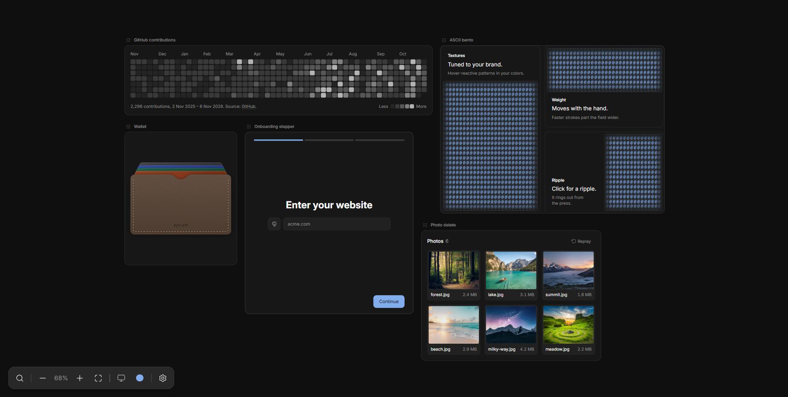

# ui-lab

My scratchpad for building interface elements that are fiddly to get right: one-time-code inputs, steppers, forms, meshes. Each one lives on an infinite canvas where I can drag it around, poke at it, and tune it until the motion feels right.



Everything shares one design and motion system. Same tokens, same springs, same hover and press behavior. That consistency is the point. A single good component is easy. A dozen that feel like they belong together takes more work.

## How it works

- Every element is a canvas item, registered in `src/canvas/registry.tsx` with its preview in `src/canvas/previews/`.
- Inspect changes settings live on the real canvas, so I can try a setting without editing code.
- Clicking an item's name copies a prompt with the component, its local imports, and the relevant parts of `DESIGN.md`. Paste it into another project's agent and it rebuilds the element there.

`DESIGN.md` describes the system: colors, type, shapes, motion, interaction. `AGENTS.md` has the rules agents follow when they work here.

## Running it

The project uses [Vite+](https://viteplus.dev).

```sh
vp install
vp dev
```

`vp check` formats, lints, and type checks. `vp test` runs the tests.

## Hillclimb UI

I built [hillclimb-ui](.agents/skills/hillclimb-ui/SKILL.md) to take the way I work in this lab into other projects. I want an agent to understand the existing design system, ask enough questions to understand what I'm after, and keep improving the actual UI through review. It works for new elements, marketing pages, and existing interfaces that need polish.

The loop came from [Theo's video on hill-climbing UI with an AI council](https://www.youtube.com/watch?v=xq0eB8vxeqk). Independent models inspect the rendered interface, explain what's weak, and review it again after changes. Comparing each version against the original and reference interfaces gives the agent something concrete to improve. The skill adds the design-system discovery, interview, and direction-setting I want before that loop starts.

### Use it

The project needs an existing design system and a UI the agent can run and inspect. Copy the whole [`hillclimb-ui` folder](.agents/skills/hillclimb-ui), including `references`, into your agent's skills directory. It includes adapters for Claude Code and Codex and has no dependency on this lab's other skills.

Ask your agent to use it with a brief, for example:

```text
Use /hillclimb-ui to build a pricing section using this project's design
system. Help visitors compare the plans and choose one.
```

```text
Use /hillclimb-ui to polish the account settings flow. Keep its current
structure, focus on hierarchy and interaction, and use three reviewers.
```

For the default council, both Claude Code and Codex CLIs need to be available and authenticated. Browser checks use your configured tools, with Chrome DevTools or Playwright MCP preferred when available. If a reviewer or inspection tool is missing, the agent asks about a fallback.

### What to expect

1. The agent reads the design system and inspects the surrounding interface, then interviews you about purpose, behavior, content, and taste.
2. It presents a few sketches and waits for your direction. Ask for working variants if you need to feel the alternatives before choosing.
3. It builds the chosen direction, exercises its states, and captures screenshots and motion evidence.
4. Independent reviewers critique the same candidate. The main thread judges their findings, makes changes, and repeats the review.
5. You get the result with before-and-after evidence, review history, verification results, and unresolved tradeoffs.

The council defaults to two, three, or four reviewers depending on implementation depth. You can specify the count and models. Reviewers use separate contexts, and the target score and earlier scores stay hidden from them. The main thread keeps your brief and the design system as the basis for accepting changes.

The proposed target is at least 9 out of 10 on every agreed criterion from every reviewer, backed by observed improvements and passing checks. There is no built-in deadline or iteration cap. The agent keeps working until it meets the target, you stop it, or a missing capability blocks progress. You can set your own limits. Council scores guide the work; you still decide whether the result feels right.

## Inspirations

- [Interaction lab by Emil Kowalski](https://x.com/emilkowalski/status/2115789995860517254). This is why the repo exists. Seeing a place built just for experimenting with motion and complex UI made me want my own.
- [Fluid Functionalism](https://fluidfunctionalism.com/). The fluid hover, press motion, and base components come from its registry. The copies here have drifted with local edits.
- [jakubkrehel/skills](https://github.com/jakubkrehel/skills). The agent skills in `.claude/skills` are distilled from these and lean on them heavily.
